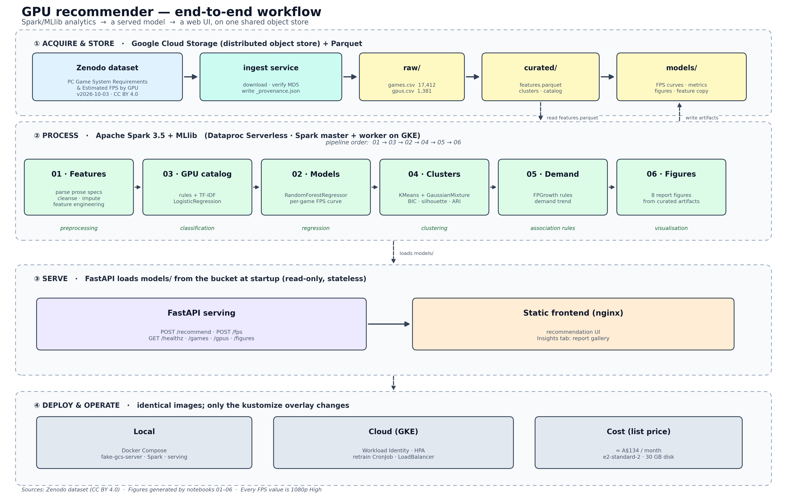

# Workflow and framework



*Figure 1 — End-to-end workflow. The same images run locally (Docker Compose,
fake-GCS emulator) and on GKE; only the kustomize overlay changes.*

## The four bands

| Band | What happens | Key components |
|---|---|---|
| **① Acquire & store** | The versioned Zenodo dataset is downloaded and MD5-verified, then written to the object store as `raw/`. Notebooks derive `curated/features.parquet` and publish the serving artefacts under `models/`. | `ingest`, Cloud Storage (fake-gcs-server locally / GCS on GKE), Parquet |
| **② Process** | Six notebooks run in order on Spark 3.5 + MLlib: cleanse/feature-engineer, classify the GPU catalogue, train the tier model and FPS curve, cluster demand levels, mine rules, and render report figures. | Dataproc Serverless / Spark master + worker |
| **③ Serve** | A stateless FastAPI service loads `models/` from the bucket at startup and exposes `/recommend` and `/fps`; the nginx frontend consumes the API and shows the figures in an Insights tab. | FastAPI, nginx, one LoadBalancer |
| **④ Deploy & operate** | One image set, two environments. Local uses Docker Compose and the GCS emulator; GKE uses Workload Identity, an HPA and a suspended retrain CronJob. | Docker, k8s + kustomize |

## Analytical tasks in the pipeline

| Notebook | Task | Spark MLlib algorithm |
|---|---|---|
| `01_features` | Preprocessing | Spark SQL / DataFrame (no UDFs) |
| `03_gpu_catalog` | **Classification** | TF-IDF + Logistic Regression |
| `02_models` | **Regression** | Random Forest Regressor (+ closed-form FPS curve for serving) |
| `04_game_clusters` | **Clustering** | K-Means + Gaussian Mixture, k by BIC |
| `05_demand_patterns` | **Association rules** | FP-Growth |
| `06_visualisations` | Outcome visualisation | — (reads curated artefacts) |

## Regenerate the figure

```bash
python docs/render_workflow.py
```

Writes `figures/00_workflow.png` (300 dpi, for the report) and
`figures/00_workflow.svg` (vector, for slides or print).
